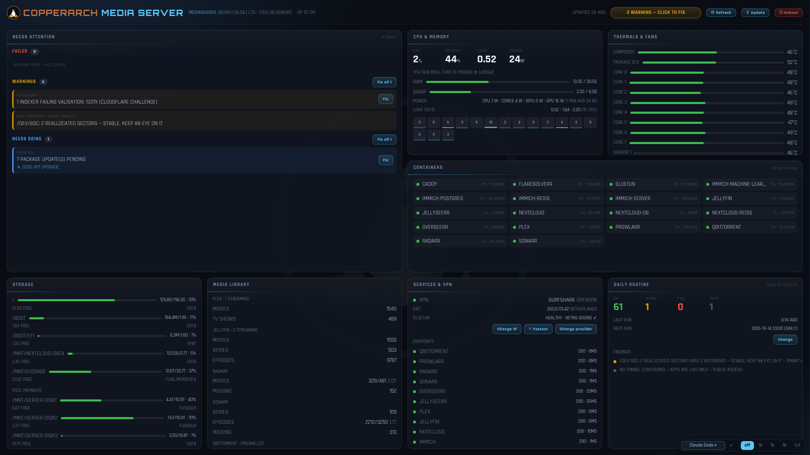
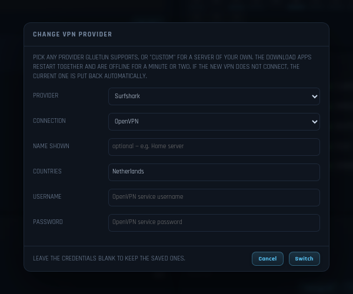
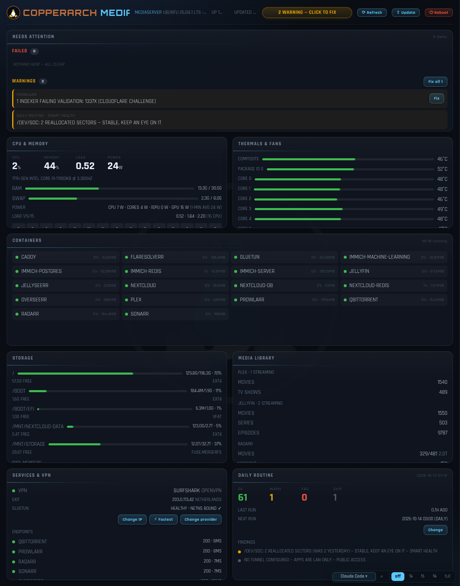

# CopperArch Media Server

**Turn a Linux PC into a home media server that looks after itself.** One
installer sets up the streaming apps, the download apps behind a VPN, a
dashboard that shows the whole machine at a glance, and a nightly routine
that finds and fixes problems while you sleep.

It runs on **Ubuntu/Debian, Fedora, Arch and openSUSE** and their relatives.



## What it does

1. **Asks a few questions**, in a graphical wizard or in the terminal: where
   your media lives, which VPN you use, which apps you want.
2. **Installs and wires everything together** with Docker: Plex, Jellyfin,
   Sonarr, Radarr, Prowlarr, qBittorrent, Seerr, Nextcloud, Immich and more.
3. **Puts the download apps behind the VPN.** They can only reach the internet
   through it; if the VPN drops, they are cut off rather than exposed.
4. **Gives you a dashboard** with one-click fixes for the things that go wrong.
5. **Keeps itself healthy** with a routine that runs every night.

## Features

**Media and downloads**
- Plex and Jellyfin for streaming; Sonarr, Radarr and Prowlarr to find and
  organise films and series; qBittorrent to download; Seerr for requests.
- Nextcloud for files and Immich for photos, each with its database.
- Caddy reverse proxy and an optional DuckDNS updater.
- Several drives pooled into one library with mergerfs.

**VPN**
- Any provider [gluetun](https://github.com/qdm12/gluetun) supports (Mullvad,
  NordVPN, Proton VPN, Surfshark, Windscribe and about twenty others), over
  OpenVPN or WireGuard, or a server of your own.
- **Change provider** from the dashboard. If the new VPN does not connect, the
  old one is put back automatically.
- **Change IP** and **Fastest** buttons, and optional hourly exit rotation.

**Dashboard**
- CPU, memory, swap, temperatures, power and disks, live every 2 seconds.
- Every container, service, the VPN and the media library, refreshed every
  10 seconds.
- A **Needs attention** list with a **Fix** button next to each problem. Fixes
  come from a fixed whitelist; the page cannot run anything else.
- Update, Reboot and Refresh buttons; a schedule dialog for the nightly run.
- A terminal dock for a shell, logs, or an AI assistant.
- Only reachable from the machine itself (loopback).

**Self-healing**
- Nightly: disk health (SMART), crash-looping containers, stalled downloads,
  dead indexers, duplicate media, app updates with rollback if one breaks,
  backups, system updates.
- Nightly security check: host firewall on, VPN kill switch and IP/DNS/IPv6
  leaks, what the internet can actually reach (probed from outside through
  the VPN), new Docker ports or Tailscale Funnel addresses, secret files
  readable by others, and Caddy/cloudflared kept up to date. It fixes what it
  safely can (firewall back on, file permissions, qBittorrent stopped on a
  leak, Caddy rebuilt on a new release) and reports the rest on the dashboard.
- The installer is safe to run again: on a drifted machine it repairs what
  changed and leaves the rest alone.

**Reproducible**
- Your answers are saved as a profile file. Give it to the installer on
  another machine, even a different distro, and you get the same setup.
- `--dry-run` shows what would happen without changing anything.

**Optional local AI**
- Off by default. Installs Ollama with an open-weights model sized to the
  machine's RAM and adds chat panes to the dashboard. Free and offline.

## Screenshots

| Changing VPN provider | Narrow window |
|---|---|
|  |  |

The screenshots use a demonstration machine: host name, addresses and
downloads are made up.

## Related projects

- [freebsd-media-setup-with-dash](https://github.com/CopperArch/freebsd-media-setup-with-dash):
  the same server on FreeBSD, with jails instead of Docker.
- [CopperBSD](https://github.com/CopperArch/CopperBSD): a FreeBSD
  distribution with the media server built in and a native dashboard.

Repo: `github.com/CopperArch/CopperArch-Linux-Media` (renamed from
`linux-media-setup-with-dash`; old links redirect automatically).

## What it installs

| Component | Contents |
|---|---|
| **Media stack** | Plex, Jellyfin, Immich (+DB/ML), Nextcloud stack, Seerr, Portainer, Tugtainer, WatchState, Caddy reverse proxy |
| **VPN stack** | Gluetun (VPN hub), qBittorrent, Sonarr, Radarr, Prowlarr, Seerr-v2, FlareSolverr/Byparr, KasmVNC Chrome (magnet handler wired to qBittorrent) |
| **Dashboard** | Local status page (loopback-only HTTP server), live host gauges (2 s) and a 10 s collector, one-click repair API (origin-guarded, whitelisted fixes only), terminal panes via ttyd (`--check-origin`), desktop window with below-layer KWin rule |
| **Self-healing** | Nightly `daily-routine.sh` at 03:00: SMART health, security & firewall check, container crash-loop detection, VPN IP rotation, qBittorrent queue self-heal, media-stack auto-update with verify+rollback, dashboard re-install on drift, docker log-rotation guard, backups, system updates |
| **Cron jobs** | Daily routine, DuckDNS updater, wastebin emptier, hourly VPN exit rotation |
| **Local AI** *(opt-in, off by default)* | Ollama + Z.ai's official open-weights GLM, sized to the machine's RAM (`glm-4.7-flash`, 19 GB, on ≥24 GB RAM; otherwise `glm4:9b`, 5.5 GB). Free and offline; adds GLM chat/ask panes to the dashboard only on machines where it was chosen, models stored on the media pool, updated nightly |

Everything it writes is idempotent — run the installer again on a drifted
machine and it repairs itself. The nightly routine re-checks the same things,
so the system keeps healing itself long after the install.

## The profile is the key

The installer asks you questions once and saves the answers as a **profile
YAML**. Hand that file to the installer on another machine (Ubuntu today,
Fedora tomorrow) and you get the same setup.

- **Your profile, your data**: a profile carries *choices*, not installer
  logic. Secrets (VPN credentials, passwords) live in it too, `chmod 600` —
  treat it like a password file.
- **Someone else's profile**: loading a friend's profile installs *their*
  choices but then asks *you* for your own credentials — it never copies their
  secrets unless they deliberately left them in.
- **No profile?** Start fresh: the wizard asks the questions and generates
  strong passwords for every service.

## Usage

```bash
# graphical wizard (tkinter)
python3 install.py

# terminal installer
python3 install.py --cli

# reproduce an existing machine from its saved profile
python3 install.py --cli --profile my-profile.yaml

# see what would happen without changing anything
python3 install.py --cli --profile my-profile.yaml --dry-run

# no prompts at all (scripted installs)
python3 install.py --cli --profile my-profile.yaml --yes
```

Every step that changes the system shows an explicit **accept** prompt:
system packages, Docker engine, config writes, cron jobs, starting
containers. Untick what you don't want; the installer is safe to re-run.

After the install, the profile can be saved for reuse
(`--save-profile my-profile.yaml`, or the GUI's "Save profile…" button).

## Distro support

Distro detection and every package install go through a single platform
layer (`lib/platform.py`) with per-family package maps:

| Family | Distros | Package manager |
|---|---|---|
| apt | Ubuntu, Debian, Mint, Pop!_OS | `apt-get` |
| dnf | Fedora, CentOS, Rocky, Nobara | `dnf` (+ Docker CE repo setup) |
| pacman | Arch, EndeavourOS, CachyOS, Manjaro | `pacman` |
| zypper | openSUSE | `zypper` |

Notes:
- **Arch**: `mergerfs` and `ufw` live in the AUR — the installer skips them
  and prints what to do; everything else installs from official repos.
- **Fedora**: Docker CE is installed from Docker's official repository.
- **Firewall** is best-effort: `ufw` on Debian-family, `firewalld` on Fedora,
  a printed note on Arch.
- The **nightly routine is one script for every distro.** The parts that
  differ are in `daily-routine-distro.sh`:

  | | Ubuntu/Debian | Fedora | Arch | openSUSE |
  |---|---|---|---|---|
  | Count pending updates | `apt list --upgradable` | `dnf check-update` | `checkupdates` | `zypper list-updates` |
  | Security updates | the `-security` pocket | `dnf advisory list --security` | not separate | security patches |
  | Install updates | `apt-get upgrade` + `autoremove` | `dnf upgrade --refresh` + `autoremove` | `pacman -Syu`, then `paccache -rk2` | `zypper update` (`dup` on Tumbleweed) |
  | Reboot due | `/var/run/reboot-required` | `dnf needs-restarting -r` | running kernel's modules are gone | `/run/reboot-needed` |
  | Sudo rules installed | `daily-routine.sudoers` | `.sudoers.dnf` | `.sudoers.pacman` | `.sudoers.zypper` |

  Everything else in the routine is shared, so a change to it reaches every
  distro at once. The dashboard's update count and its **Fix** button go
  through the same file. The sudo rules allow exactly those commands and are
  checked with `visudo -c` before they are installed.
- **Cron and SMART services** are switched on by the installer (`cronie` and
  `smartd` are installed but left off by default on Fedora, Arch and
  openSUSE).
- **SMART checks** cover every internal SATA/NVMe disk automatically. Disks
  in USB enclosures are left alone unless you list them in
  `~/.config/status-dashboard/smart-include` (some USB bridges hang when
  probed); `smart-skip` in the same folder leaves a disk out. Each takes part
  of a `/dev/disk/by-id` name per line.
- `scripts/test-routine-distros.sh` runs the update logic for real in a
  throwaway container of each distro, as an ordinary user holding only the
  routine's sudo rules. Run it after changing the routine.

## Choosing your VPN

The VPN stack runs on [gluetun](https://github.com/qdm12/gluetun), so the
installer takes any provider gluetun has a server list for — AirVPN,
CyberGhost, ExpressVPN, FastestVPN, Giganews, HideMyAss, IPVanish, IVPN,
Mullvad, NordVPN, Perfect Privacy, Privado, Private Internet Access,
PrivateVPN, Proton VPN, PureVPN, SlickVPN, Surfshark, TorGuard, VPNSecure,
VPN Unlimited, VyprVPN, Windscribe — over **OpenVPN** (`vpn_user` /
`vpn_password`) or **WireGuard** (`vpn_wg_private_key` / `vpn_wg_addresses`).

For a server of your own, or a provider that isn't listed, set
`vpn_provider: custom`:

- **WireGuard** — add the server's `vpn_wg_public_key`, `vpn_wg_endpoint_ip`
  and `vpn_wg_endpoint_port` (plus `vpn_wg_preshared_key` if it uses one).
- **OpenVPN** — point `vpn_openvpn_config` at your `.ovpn` file; the installer
  copies it into the stack and gluetun connects with it.

A custom server is a single fixed endpoint, so hourly exit rotation is turned
off for it. The dashboard's VPN card names the VPN that is active (set
`vpn_name` to choose the label for a custom one) along with the protocol and
the current exit IP.

To switch later, use **Change provider** on the dashboard's VPN card: pick the
provider and connection type, enter its credentials (or paste your own
server's details), and press Switch. The download apps restart together and
are offline for a minute or two. If the new VPN has not connected after 2½
minutes the previous settings are put back and the old VPN reconnects, so a
typo cannot leave you without one. The settings it replaces are kept next to
the stack as `.env.bak-<date>`.

## Self-healing, in three layers

1. **systemd** — dashboard server/terminal units run with `Restart=always`,
   the collector runs every 10 s from a timer, and the page reads CPU, memory, swap, temperatures and disks from the server every 2 s.
2. **Dashboard repairs** — the web dashboard exposes a closed whitelist of
   fixes (container start/restart, VPN recreate/rotate/find-fastest-exit,
   Prowlarr test-all,
   Cloudflare-ban unblock, apt upgrade, quick routine, container-update
   apply/skip). Guards: loopback binding, `Sec-Fetch-Site`/Origin CSRF
   checks, 64 KB body cap, confirmed reboot endpoint, argv-list execution
   only. The AI chat panes (Claude Code, opencode, and the OpenRouter
   models) run under `tmux`, so closing the terminal dock only detaches the
   session instead of killing whatever the agent was doing — reopening the
   same pane reattaches to it. The picker's **Free** section lists every
   model that is currently free on OpenRouter — rebuilt nightly, and
   re-checked live before a free pane starts so it can never bill — and
   paid models show their price in pounds at the day's exchange rate. Drag (or double/triple-click) to highlight
   text in a pane — it's copied straight to the desktop clipboard, even
   while the agent has grabbed the mouse. A running repair or update can be
   stopped with **Cancel** (two clicks — interrupting an upgrade half-way
   can leave it half-applied); it stops the whole command, including what
   runs under sudo, and skips anything still queued. Where the CPU exposes
   RAPL power counters (or a GPU exposes an energy sensor), a small root
   service (`power-sampler.py`) publishes averaged watts and the CPU &
   memory panel shows a **Power** tile.
3. **Nightly routine** — `daily-routine.sh` re-installs drifted dashboard
   units, re-applies gluetun iptables rules, verifies the docker log-cap
   policy, auto-updates the arr stack with verify+auto-rollback (including a
   60-day cap so a hard-pinned tag or a remembered-bad image is never
   skipped forever), and runs `media-stack-selfheal.py` (qBittorrent queue +
   dead-torrent recovery). Everything else (Immich, Portainer, Tugtainer,
   WatchState, Caddy, gluetun, Prowlarr's own dependency `flaresolverr`) is
   pulled and checked nightly by `docker-update-gate.py` but never
   auto-applied — a genuinely newer image just flags an amber "update
   available" bubble on the dashboard, and you choose Update or Skip from
   there. VPN IP rotation retries up to 3 restarts before giving up (a
   single bad exit node used to leave the tunnel dead for hours), and both
   it and the hourly `gluetun-rotate.sh` cron alert by email
   (`send-alert.py`, debounced so a prolonged outage sends one mail, not one
   an hour) if the tunnel won't come back — `media-stack-selfheal.py` also
   checks the tunnel directly (`vpn_tunnel_health()`) rather than trusting
   gluetun's Docker healthcheck, which stays "healthy" even when OpenVPN is
   stuck failing auth in a loop.

   The routine also keeps the media libraries tidy:
   `jellyfin-duplicates.sh` finds the same movie or episode stored twice,
   keeps the best copy (resolution, then bitrate, then size) and **deletes
   the others from disk** — it is off until you create a Jellyfin API key in
   `~/.dbmedia/jellyfin-api-key`; run it by hand without `--apply` to see
   what it would remove. Copies Sonarr/Radarr track are removed through
   their API so the kept copy is adopted rather than re-downloaded, and
   titles whose running times disagree are reported, never deleted.
   `media-library-sort.py` moves TV episodes that landed in the movies
   folder (and movies in the TV folder) to the right place — renames on the
   same disk only, never overwrites, skips anything Radarr/Sonarr manage or
   that changed in the last 2h. `media-library-health.py` then makes sure
   every movie franchise with 2+ films has a Jellyfin collection (TMDB
   franchise data via Radarr; movies Jellyfin couldn't identify are matched
   by cleaned-up title only when an independent IMDb search agrees), keeps
   Plex's automatic collections on, and actually fetches every poster in
   both apps, re-fetching broken ones. Files with no TMDB franchise can be
   grouped by hand in `~/.config/media-library/manual-collections.json`
   (collection name → pieces of file names, plus optional title fixes),
   which is re-applied to both apps every night. A disk-space step removes
   Docker images nothing needs (keeping anything a container, compose file
   or pending update uses), stale test-VM disks / stock install media in
   `~/build-iso`, and Chrome's 4 GB on-device AI model if it reappears, then
   warns when the root disk is still 80%+ full. Don't install Jellyfin's
   "TMDb Box Sets" plugin alongside it: that plugin deletes any collection
   it didn't build itself.

## Repository layout

```
install.py              # entry point (GUI by default, --cli fallback)
installer/cli.py        # terminal installer
installer/gui.py        # tkinter wizard
lib/platform.py         # distro detect + package maps
lib/profile.py          # profile load/save/validate
lib/render.py           # {{PLACEHOLDER}} template renderer
lib/steps.py            # ordered install steps
lib/util.py             # run/log/sudo helpers
templates/              # your exact system, templatized
  bin/ttyd              # static terminal binary
  daily-routine.sh      # nightly self-healing routine
  media-stack-*.py      # self-heal + verified auto-update
  docker-update-gate.py # nightly pull+flag for the rest; apply/skip is manual
  status-*              # dashboard collector/server/installer
  index.html            # the dashboard page
  stacks/media-stack/   # compose + caddy (DuckDNS build)
  stacks/vpn-stack/     # gluetun/qbit/arr/seerr/chrome compose + Kasm build
  units/                # post-reboot check unit
  etc/                  # root-owned helpers + sudoers
profiles/example.yaml   # fill-in template profile
scripts/dry-run.sh      # offline full dry-run test
```

## Privacy

Templates in this repo contain no personal data — names, domains, IPs,
credentials and API keys are all `{{PLACEHOLDER}}` values rendered from the
profile at install time. The example profile ships with blanks.

## Requirements

- Any systemd distro from the table above (x86_64 for the bundled ttyd)
- Docker-capable kernel (the installer installs Docker if missing)
- A desktop session for the dashboard window (the server/collector run
  headless too)

## License

MIT — see [LICENSE](LICENSE).
